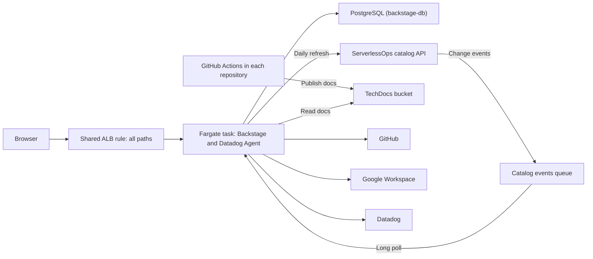
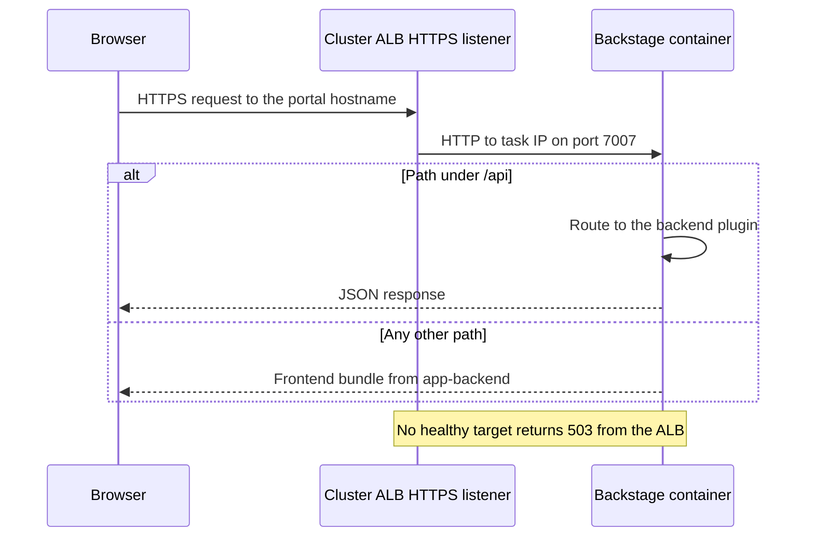
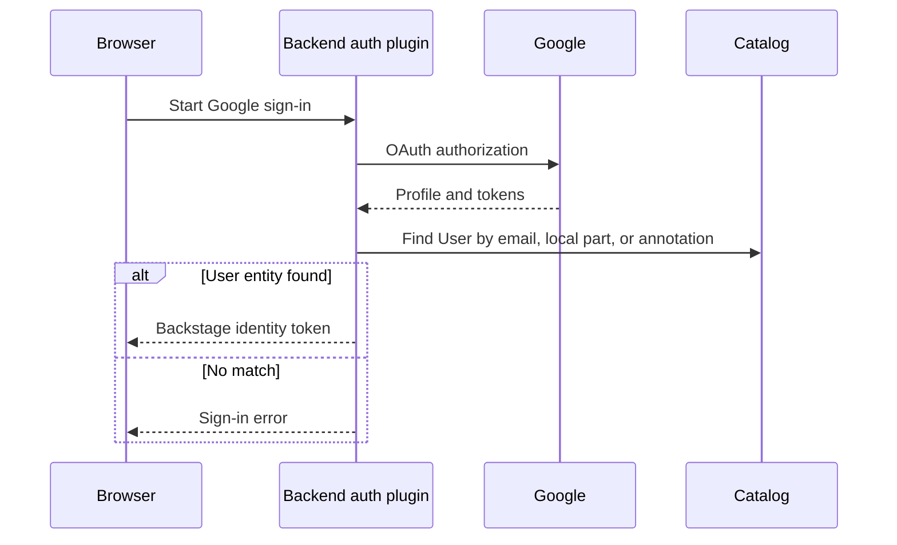
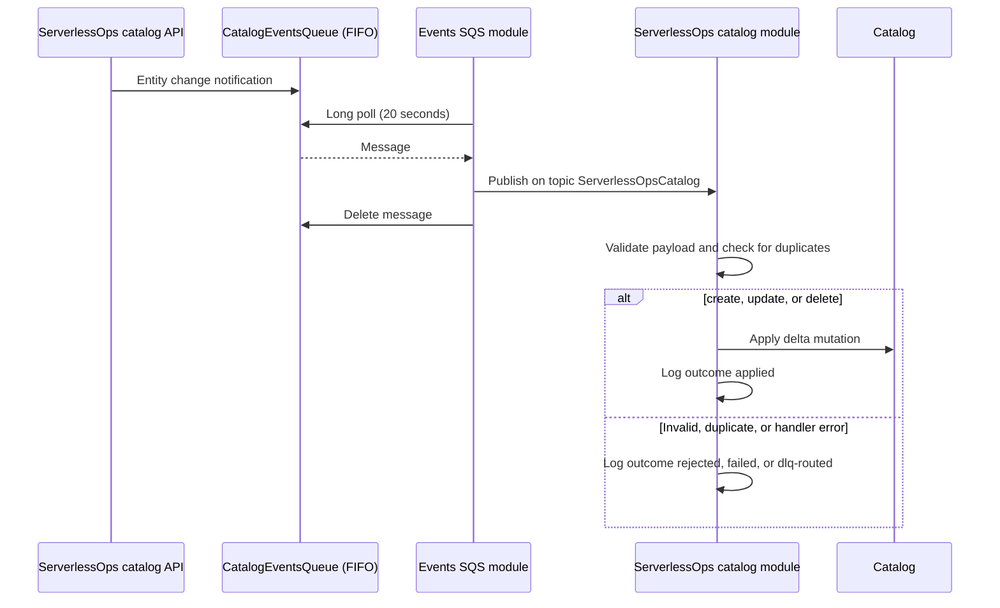
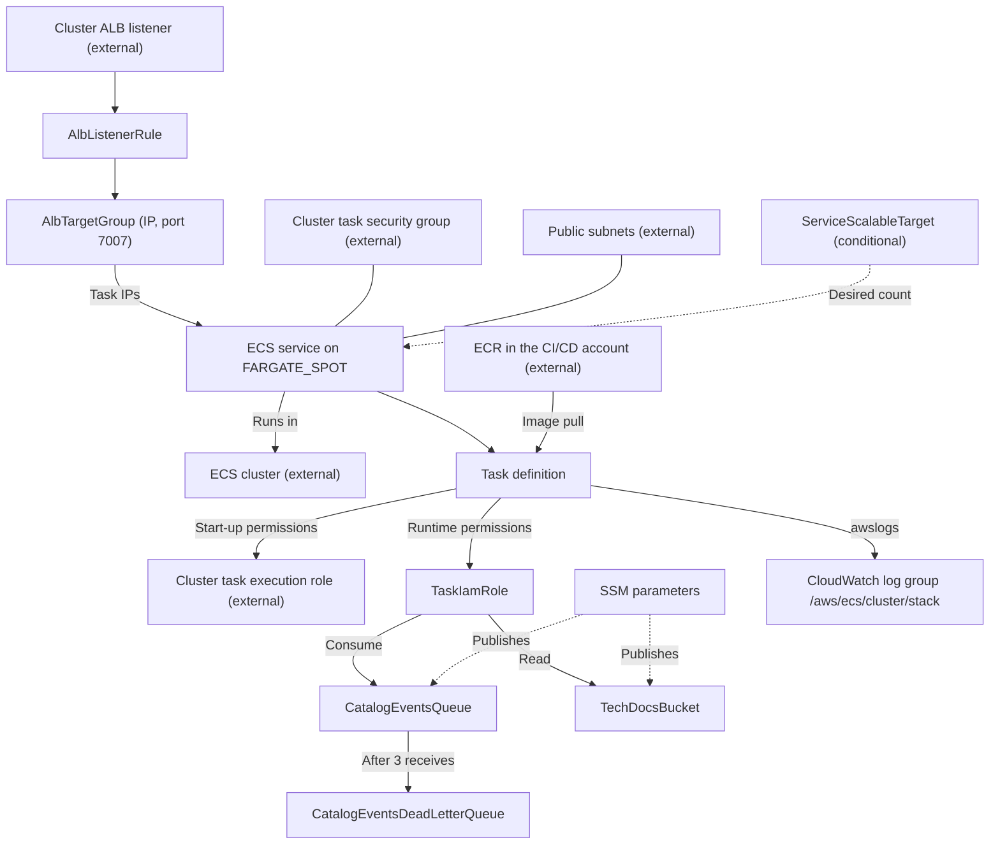

# Architecture

## Infrastructure

### Logical architecture

- Browsers reach the portal through the cluster's shared ALB. One listener
  rule sends every path to this service.
- A single Fargate task runs the Backstage container, which serves both the
  frontend bundle and the backend API on port 7007, alongside a Datadog Agent
  sidecar.
- The backend keeps its state in PostgreSQL, provided by `backstage-db`.
- The catalog is filled by polling GitHub, Google Workspace, and the
  ServerlessOps catalog API, and by change events the catalog API sends to an
  SQS queue this stack owns.
- TechDocs are built and published by GitHub Actions into an S3 bucket this
  stack owns; the backend only reads them.
- Cluster and network identifiers are resolved from SSM at deploy time.

#### Logical architecture diagram



#### Page request sequence



The ALB terminates TLS; traffic to the task is plain HTTP inside the VPC.

#### Sign-in sequence



#### Catalog ingestion

| Provider | Trigger | Mutation |
| --- | --- | --- |
| GitHub (`serverlessOpsIO`, `pitCrewIO`, and the two `*Specs` providers) | Every 30 minutes | Discovers `catalog-info.yaml` files on `main` |
| Google users and groups | Every 12 hours, 5 seconds after start | Full replacement |
| ServerlessOps catalog, scheduled | Every day, 5 seconds after start | Full replacement of `Domain`, `System`, `Resource`, `Users`, and `Group` in namespace `default` |
| ServerlessOps catalog, events | Each message on the `ServerlessOpsCatalog` topic | Delta: add, update, or remove one entity |

#### Catalog event sequence



The catalog API's EventBridge Pipes read this stack's queue ARN from SSM and
send to it. The module ignores a repeated `eventId` for the same entity; that
guard is held in memory, so it resets when the task restarts.

The events SQS module deletes each batch after publishing it to the in-process
event bus, whatever the subscriber then does. A `failed` or `dlq-routed`
outcome is therefore a log classification: the message is not redelivered, and
the daily full refresh is what repairs a missed change. Messages reach the
dead-letter queue only if the consumer receives them three times without
deleting them, for example while the backend cannot call SQS.

### Physical architecture



`template.yaml` owns the task definition, service, task role, optional scaling
target, target group, listener rule, both queues, the TechDocs bucket, and four
SSM parameters. The cluster, ALB and listener, task security group, task
execution role, VPC and subnets, database, image registry, and CI roles are
external dependencies. The log group is created by the `awslogs` driver at
first use, not by CloudFormation.

### CloudFormation template

`template.yaml` is the infrastructure-as-code entry point. Its
`Transform: AWS::Serverless-2016-10-31` enables AWS SAM processing; the
resources are standard CloudFormation types.

| Section/resource | Purpose |
| --- | --- |
| `Parameters` | Catalog metadata, branch, cluster and network SSM references, image, sizing, scaling schedule, load balancer rule, and application configuration. |
| `Conditions` | `ServiceScalingEnabled`, `ServiceScaleOutEnabled`, and `ServiceScaleInEnabled`, derived from the two cron parameters. |
| `TaskDefinition` | Fargate task with the application container, its environment, and the Datadog Agent sidecar. |
| `Service` | Desired count, Spot capacity, networking, deployment settings, ECS Exec flag, and target-group registration. |
| `ServiceScalableTarget` | Scheduled scale-out and scale-in actions. Created only when a schedule is set. |
| `AlbTargetGroup`, `AlbListenerRule` | Target group and path rule on the cluster listener. |
| `TaskIamRole` | Runtime permissions: consume the events queue and read the TechDocs bucket. |
| `CatalogEventsQueue`, `CatalogEventsDeadLetterQueue` | FIFO queue with content-based deduplication, a 60-second visibility timeout, and redrive after three receives; the dead-letter queue retains messages for 14 days. Both use SQS-managed encryption. |
| `TechDocsBucket` | S3 bucket with default settings and a generated name. |
| `CatalogEventsQueue*Parameter`, `TechDocsBucketNameParameter` | SSM parameters under `/<domain>/<system>/<component>/<branch>/`: `SqsQueueArn`, `SqsQueueName`, `SqsQueueUrl`, and `TechDocsBucketName`. |

The bucket has no `DeletionPolicy`, so deleting the stack fails while the
bucket holds objects. The queue names include the branch, so a second stack
from another branch would not collide on them.

### IAM roles

| Role | Assumed by | Permissions | Owner |
| --- | --- | --- | --- |
| Task execution role | ECS agent, while starting tasks | Image pull and log delivery | `backstage-cluster` |
| `TaskIamRole` | Application code at runtime | `sqs:ReceiveMessage`, `DeleteMessage`, `DeleteMessageBatch`, `ChangeMessageVisibility`, `GetQueueAttributes`, and `GetQueueUrl` on the events queue; `s3:GetObject` and `s3:ListBucket` on the TechDocs bucket | This stack |

Grant anything the backend calls in AWS to `TaskIamRole`, scoped to specific
resources. The task role cannot write to the TechDocs bucket by design:
publishing uses the deployment role in GitHub Actions.

### Networking

Tasks use `awsvpc` mode with an ENI in a public subnet and a public IP. The
cluster's task security group is attached to every task. The target group
registers task IPs directly (`TargetType: ip`). The database must admit the
task security group on the PostgreSQL port.

## Software

### Repository file layout

```text
catalog-info.yaml                  Backstage Component entity
mkdocs.yml                         TechDocs site configuration
docs/handbook/                     Handbook pages
specs/                             Spec Kit feature specs, one directory each
template.yaml                      ECS service infrastructure
cfn-parameters.json                Deployment-action parameter expressions
cfn-tags.json                      Deployment-action tag expressions
samconfig.toml                     SAM build, validation, and deploy defaults
.github/workflows/main.yml         Build and deploy on main
.github/workflows/branch.yml       Build only on other branches
.github/workflows/techdocs-*.yml   Publish docs/ and specs/ as TechDocs
.github/workflows/ecr-policy.json  ECR repository policy for built images
.github/skills/, .specify/         Spec Kit skills, templates, and scripts
src/                               Backstage monorepo
```

### Backstage monorepo layout

```text
src/package.json                   Workspace root, scripts, Node and Yarn versions
src/backstage.json                 Backstage release version
src/app-config*.yaml               Application configuration layers
src/app-config.d/                  Local templates and CI-written credentials
src/Dockerfile                     Final image: tools, RDS CA bundle, app-config.d
src/packages/app/                  Frontend app shell
src/packages/backend/              Backend entry point and base image Dockerfile
src/plugins/                       Local plugins and modules
src/examples/                      Example entities for local development
src/app-config.test.ts             Home page layout test
```

The workspace uses Yarn 4.15.0 with the `node-modules` linker and the Backstage
Yarn plugin, which resolves `backstage:^` dependency ranges to the versions in
the release named by `src/backstage.json`. `src/package.json` pins Node.js
`v24.16.0`.

### Frontend and backend wiring

`src/packages/app/src/App.tsx` calls `createApp` with the catalog, home, and
scaffolder plugins, three community GitHub plugins, the five local frontend
modules, and an `app` module holding the sign-in page. `app.packages: all`
discovers the remaining plugins from the app's dependencies, so installing a
plugin package is usually enough to enable it.

`src/packages/backend/src/index.ts` calls `createBackend` and adds each plugin
and module by import. Nothing is discovered automatically on the backend.

### Container image anatomy

The image is built in two stages by two Dockerfiles:

| Stage | Dockerfile | Result |
| --- | --- | --- |
| Base | `src/packages/backend/Dockerfile`, run by `yarn build-image` | `backstage:latest`: `node:24-trixie-slim`, Python with `mkdocs-techdocs-core`, production dependencies, the backend bundle, and `app-config*.yaml`. Runs as `node` in `/app`. |
| Final | `src/Dockerfile` | Adds `specify-cli`, the GitHub CLI, and the Copilot CLI; the combined RDS CA bundle for the four US regions; and `app-config.d/`. |

The base stage copies the pre-built `skeleton.tar.gz` and `bundle.tar.gz` from
`src/packages/backend/dist/`, so `yarn build:all` must run first on a host with
the same Node.js major version. The final stage builds `FROM backstage:latest`,
which exists only in the local Docker daemon of the machine that just ran the
base stage.

The backend bundle includes the frontend: the backend depends on `app`, and
`app-backend` serves the compiled bundle and injects runtime configuration.

`rds-combined-ca-bundle.pem` is referenced by
`backend.database.connection.ssl.ca` in the production configuration, so
database connections verify the RDS certificate.

### Task definition anatomy

| Container | Image | Purpose |
| --- | --- | --- |
| `backstage-app` | `<ContainerRepo>/<ContainerOrg>/<ContainerImage>:<ContainerTag>` | The portal. Port 7007; the environment in [Configuration](03-configuration.md#environment-variables-read-by-app-config); `awslogs` with stream prefix `app`. |
| `datadog-agent` | `public.ecr.aws/datadog/agent:latest` | 256 CPU / 512 MB, non-essential; `DD_API_KEY`, `DD_SITE`, `ECS_FARGATE`, `DD_LOG_LEVEL=ERROR`; `agent health` check; stream prefix `sidecar`. |

The application container has no container-level health check; the ALB target
group check is what replaces an unresponsive task.
